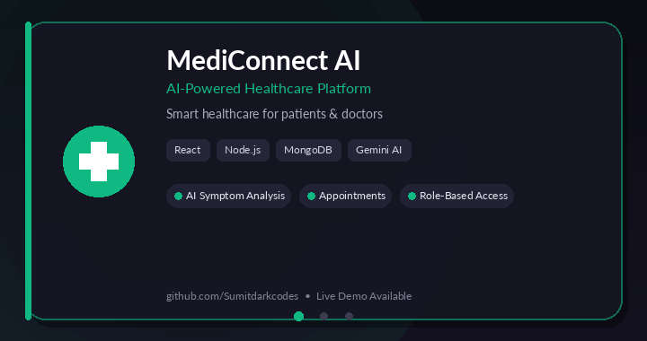
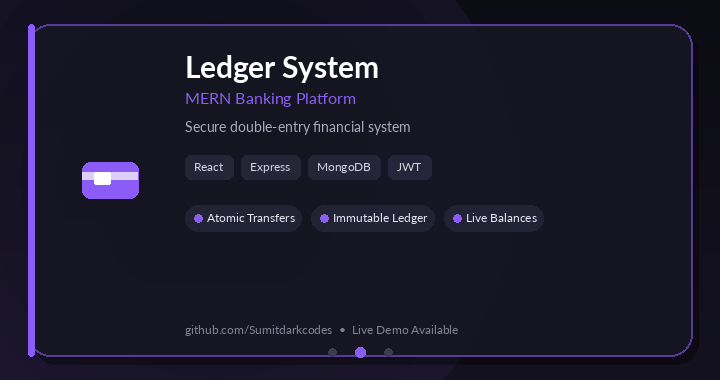
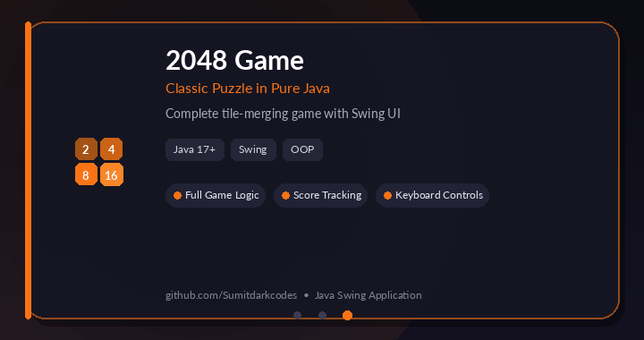

  

  
  

---

## 👨‍💻 About Me

Hi! I'm **Sumit Kumar**, a Full-Stack Developer passionate about creating useful and scalable applications.

- 🎓 M.Tech Computer Science student
- 💻 Focused on MERN Stack Development
- 🚀 Building real-world full-stack projects
- 🧠 Interested in backend architecture and AI integration
- 🎯 Preparing for Software Development Engineer roles

 

---

## ⚡ Tech Stack

  

---

## 🚀 Featured Projects

  <i>Building practical full-stack applications &amp; solving real-world problems</i>

<table width="100%">
  <tr>
    <td valign="middle" width="50%">
      <h3>🏥 MediConnect AI</h3>
      <b>AI-Powered Healthcare Platform</b>
        
      
      
      
      
      <ul>
        <li>Patient, Doctor &amp; Admin roles</li>
        <li>AI-powered symptom analysis using Google Gemini</li>
        <li>Appointment booking and healthcare management system</li>
      </ul>
      <a href="https://ai-healthcare-seven-nu.vercel.app"><strong>🌐 Live Demo</strong></a> &nbsp;•&nbsp;
      <a href="https://github.com/Sumitdarkcodes/Ai-Healthcare"><strong>🔗 Repository</strong></a>
    </td>
    <td valign="middle" align="center" width="50%">
      
    </td>
  </tr>
</table>

---

<table width="100%">
  <tr>
    <td valign="middle" width="50%">
      <h3>💳 Ledger System</h3>
      <b>MERN Banking Platform</b>
        
      
      
      
      
      <ul>
        <li>Double-entry immutable ledger system</li>
        <li>Atomic transfers with MongoDB sessions</li>
        <li>Idempotency keys and live balance calculation</li>
      </ul>
      <a href="https://banking-system-project-seven.vercel.app"><strong>🌐 Live Demo</strong></a> &nbsp;•&nbsp;
      <a href="https://github.com/Sumitdarkcodes/banking-system-project"><strong>🔗 Repository</strong></a>
    </td>
    <td valign="middle" align="center" width="50%">
      
    </td>
  </tr>
</table>

---

<table width="100%">
  <tr>
    <td valign="middle" width="50%">
      <h3>🎮 2048 Game</h3>
      <b>Classic Tile-Merging Puzzle in Java</b>
        
      
      
      <ul>
        <li>Complete game logic with tile merging</li>
        <li>Colorful Swing UI and score tracking</li>
        <li>Built with pure Java (no external libraries)</li>
      </ul>
      <a href="https://stellular-malabi-9aa333.netlify.app/"><strong>🌐 Live Demo</strong></a> &nbsp;•&nbsp;
      <a href="https://github.com/Sumitdarkcodes/2048-Game-java-"><strong>🔗 Repository</strong></a>
    </td>
    <td valign="middle" align="center" width="50%">
      
    </td>
  </tr>
</table>

---

## 🤝 Connect With Me

  
  
  

  <i>"Code. Learn. Build. Repeat."</i>

